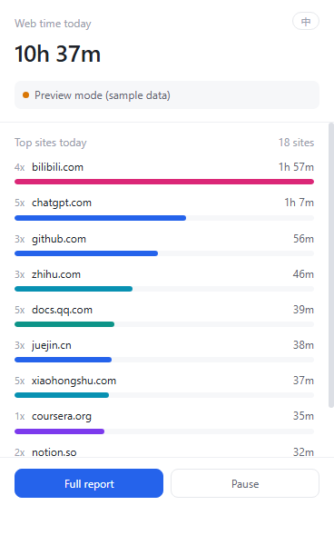
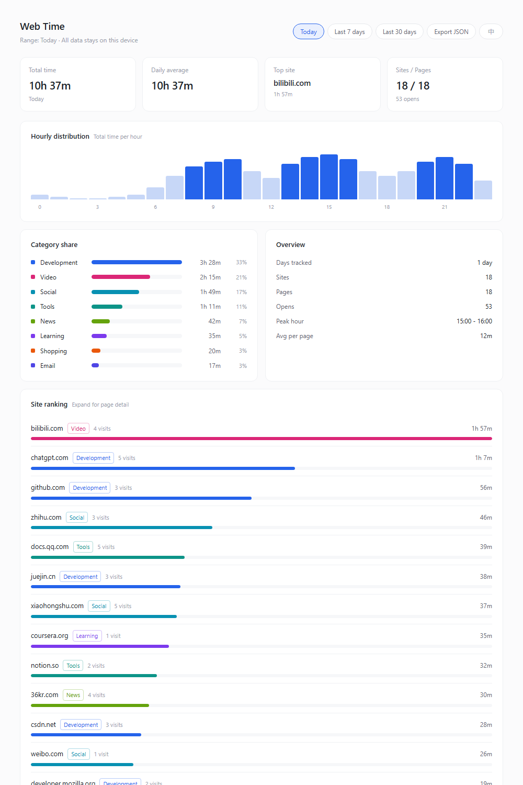

# Web Time Tracker

A local-only browser extension that measures how much time you actually spend on each web page.

**All data stays on your machine (`chrome.storage.local`). No server, no account, no telemetry, no analytics.**


| Popup | Full report |
|---|---|
|  |  |

---

## Why a browser extension, not a desktop app

If the question is "which *web page* did I spend time on", only the browser knows the answer.

| Approach | Page-level accuracy | Verdict |
|---|---|---|
| **Browser extension** | Exact — it owns the tab focus state | Used here |
| Desktop window hook | Only "browser is focused" + a window title | Wrong when several tabs are open |
| Local proxy / DNS log | None — pages with no requests (reading, video playback) are invisible | Cannot measure duration at all |

A single-browser setup also removes an entire backend: no server, no SQLite, no cross-device merge. The extension plus one report page is enough.

---

## Install

1. Open Edge (or Chrome) and go to `edge://extensions/` / `chrome://extensions/`
2. Enable **Developer mode** (bottom-left toggle)
3. Click **Load unpacked** and select this folder
4. Pin the extension from the toolbar's puzzle icon

> Sideloaded extensions stay enabled in Edge, but after a restart the browser may ask whether to disable developer-mode extensions. Choose **Keep**.

---

## How time is measured

Time is counted only when **all three** conditions hold:

1. The browser window is in the foreground
2. The tab is the active tab in that window
3. The OS is not idle (no keyboard or mouse input for 60 s by default)

Additional rules:

- **Switching away stops the clock.** Time spent in another application is not counted. Switching back resumes automatically. Because `Alt+Tab` on Windows can drop `focus` events, the state is re-verified against the real APIs every 4 s instead of trusting the event stream alone.
- **Visit counting is de-duplicated.** Only moving from page A to page B counts as a new visit; leaving and returning to the same page does not inflate the number.
- **Internal pages are skipped.** `edge://`, `chrome://`, extension pages and the new tab page are ignored.
- **The full URL is never stored.** Only `hostname + path` is kept — query strings (which may contain tokens) are dropped.
- **Gaps over 150 s are discarded** on wake, so a machine that was asleep or off is not counted as browsing.
- **Days are split at midnight**, and data older than 90 days is pruned automatically.

---

## Design notes: surviving MV3 service worker termination

This is where similar tools usually break. Manifest V3 kills the background service worker after roughly 30 seconds of inactivity, and a naive `setInterval` accumulator silently loses that time.

Six things are done here, and each one exists because of a specific failure mode:

| # | Technique | Failure it prevents |
|---|---|---|
| 1 | **Absolute timestamps** — every duration is a `Date.now()` difference, never an accumulated counter | Background tabs get throttled, so interval callbacks fire late or less often |
| 2 | **Heartbeat keep-alive** — settle every second, call a `chrome.storage` API every 5 s | Extension API calls reset the worker's idle timer |
| 3 | **State persisted** to a `runtime` key every 5 s | The worker is killed while a page is being timed |
| 4 | **Compensating settlement** — on wake, the interrupted span is credited back to the page that was active | Time is lost between the last write and the kill |
| 5 | **`chrome.alarms` fallback** every minute | Even a fully terminated worker gets restarted |
| 6 | **Serialized refresh** — event-driven and heartbeat-driven refreshes are chained through one promise | Concurrent refreshes overwrite each other's state |

State is *verified*, not assumed: every 4 s `chrome.windows.getLastFocused()` and `chrome.idle.queryState()` are queried and compared against the cached state. A dropped `onFocusChanged` event can therefore never leave the timer stuck in the paused state.

---

## Project structure

```
edge-time-tracker/
├── manifest.json          MV3 manifest
├── src/
│   ├── background.js      service worker: event listeners + timing state machine
│   ├── style.css          shared styles
│   ├── popup.html/js      toolbar popup: today's total + top 10 sites
│   ├── dashboard.html/js  full report page (options page)
│   └── lib/
│       ├── store.js       data model: in-memory cache, throttled flush, aggregation
│       ├── categories.js  hostname → category mapping
│       ├── i18n.js        zh/en message tables + formatting
│       └── demo.js        sample data, used only when opened outside an extension
├── test/
│   ├── sim.js             timing-logic simulation (13 assertions)
│   └── i18n_test.js       locale logic tests (33 assertions)
└── docs/                  screenshots
```

---

## Bilingual UI (Chinese / English)

The interface defaults to **Chinese**; a single button toggles English and back. The choice is stored under `ui:lang` and survives restarts; `storage.onChanged` keeps a popup and an open report page in sync.

Number formatting follows the locale as well:

| Chinese | English |
|---|---|
| `3 小时 25 分` | `3h 25m` |
| `18 个站点` | `18 sites` |
| `4 次` | `4 visits` |

One deliberate constraint: **category keys are stored in Chinese** (`开发`, `视频`, …) and only mapped for display. Translating them at write time would split historical data into two disjoint sets the moment the user switches language.

All strings live in the `ZH` / `EN` tables in `src/lib/i18n.js`. A missing English key falls back to Chinese rather than rendering a raw key. To force a locale without writing to storage:

```
src/dashboard.html?lang=en
```

---

## Testing

Neither suite needs the extension installed — both run in plain Node against mocked browser APIs.

```bash
node test/sim.js        # timing state machine, 13 assertions
node test/i18n_test.js  # locale logic, 33 assertions
```

`test/sim.js` drives a controllable clock through the sequences that matter: dwell, switch away, switch back, OS idle, internal pages — **including two cases that deliberately fire no events at all**, to prove the heartbeat correction can stop and restart the clock on its own.

These tests are not decoration. Writing them surfaced a real off-by-one: `ensurePage()` initialised `visits` to 1 and `markVisit()` incremented it again, so the first visit to every page was counted twice. Reading the code had not revealed it.

A manifest sanity check is included as well — it verifies that every path referenced by `background`, `action`, `options_page`, `content_scripts` and `icons` actually exists:

```bash
node test/check_ext.js .
```

### One packaging trap worth knowing

**No file or folder inside an extension directory may start with `_`.** Chromium reserves that prefix (`_locales`, `_metadata`) and refuses to load the extension:

```
Cannot load extension with file or directory name _xxx.
Filenames starting with "_" are reserved for use by the system.
```

The error has nothing to do with your code — it bites when screenshots or backups are saved next to the source. Keep artifacts outside the extension folder, and check with `find . -name "_*"` before loading.

---

## Known limitations

- Only the browser profile with the extension installed is tracked; another browser or machine has separate data (a JSON export/merge is on the roadmap).
- Incognito windows are intentionally not counted.
- With several windows open, only the focused one is tracked.
- Page-level tracking creates many entries on SPA sites; the report aggregates by hostname by default.

---

## Roadmap

| Priority | Feature |
|---|---|
| High | Per-site limit with a notification after N minutes |
| High | Daily / weekly report generated via `chrome.alarms` |
| Medium | Editable categories from the report page |
| Medium | Allowlist for excluded domains |
| Medium | Export JSON and merge across devices |
| Low | Pomodoro / focus mode tied to the timing state machine |

---

## License

MIT — see [LICENSE](LICENSE).

中文说明见 [README.zh-CN.md](README.zh-CN.md)。
