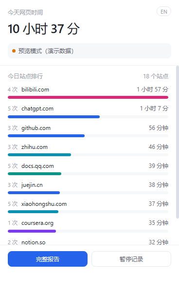
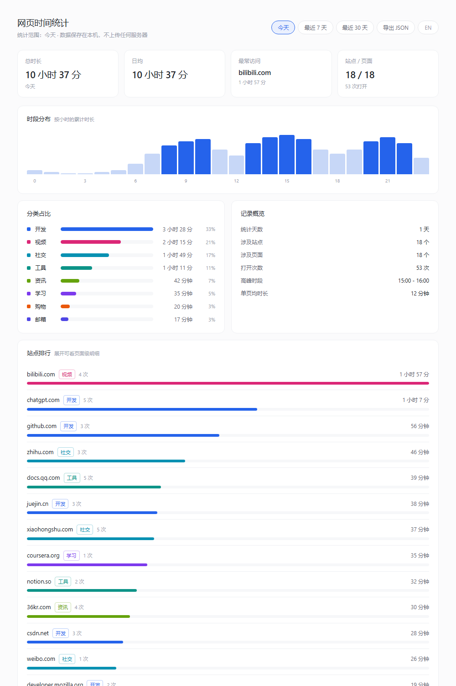

# 网页时间统计（Edge / Chrome 扩展）

一个只在本机运行的浏览器扩展，统计你在每个网页上实际花了多少时间。

**数据全部保存在本机（`chrome.storage.local`），不联网、不上传、无账号。**

> English documentation: [README.md](README.md)

| 弹窗 | 完整报告 |
|---|---|
|  |  |

---

## 一、为什么选这个方案

如果问题是"我在哪个**网页**上花了多少时间"，只有浏览器自己知道答案：

| 采集方案 | 结论 | 原因 |
|---|---|---|
| **浏览器扩展（本项目）** | 采用 | Edge 是 Chromium 内核，扩展 API 与 Chrome 完全一致；扩展自己就知道当前哪个标签在前台，网页粒度天然准确 |
| 桌面钩子程序 | 不需要 | 它只能看到"浏览器在前台"和一个窗口标题，多标签场景下猜不准具体哪个网页 |
| 本地代理 / DNS 日志 | 放弃 | 静默阅读、看视频期间没有任何请求，根本算不出时长 |

单浏览器场景的好处：**不需要后端服务、不需要 SQLite、不需要跨端合并**，扩展自身 + 一个 dashboard 页面就够了。

---

## 二、安装（30 秒）

1. 打开 Edge，地址栏输入 `edge://extensions/` 回车
2. 打开左下角的 **开发人员模式**
3. 点 **加载解压缩的扩展**
4. 选择本文件夹
5. 装好后点工具栏的拼图图标，把「网页时间统计」固定到工具栏

> 侧载扩展在 Edge 上不会被自动禁用，但浏览器重启后偶尔会弹出"是否关闭开发人员模式扩展"的提示，选择「保留」即可。

---

## 三、计时规则（关键）

只有**同时**满足下面三条时才计入时长：

1. 浏览器窗口处于前台（切到别的程序就停表）
2. 标签页是当前激活的那个（后台标签不计）
3. 系统没有进入空闲（默认 60 秒无键鼠输入就停表）

另外几条处理：

- **切窗口 = 停表**：切到别的程序立即停表（那段时间不算网页时间），切回来自动继续。为避免 Alt+Tab 时系统事件偶发漏触发导致计时卡死在暂停态，每 4 秒会用 `chrome.windows.getLastFocused()` 和 `chrome.idle.queryState()` 真实复核一次，与缓存状态不一致就立刻纠正
- **打开次数去重**：只有"从 A 页面切到 B 页面"才算一次新打开；切走再回到同一页面不会让次数虚高
- **跳过内部页面**：`edge://`、`chrome://`、扩展页、新标签页都不计
- **不存完整 URL**：只保留 `域名 + 路径`，查询参数（`?token=...`）被丢弃
- **页面归类**：网址按 `域名/路径` 作为唯一键；`github.com/user/repo` 和 `github.com/user/repo/issues/12` 会被算作两个页面，但在看板里按域名汇总展示
- **断档保护**：两次结算间隔超过 150 秒视为异常中断，不补计
- **跨天自动切分**：按自然日归属，最多保留最近 90 天

---

## 四、文件结构

```
edge-time-tracker/
├── manifest.json          扩展清单（MV3）
├── src/
│   ├── background.js      Service Worker：事件监听 + 计时状态机
│   ├── style.css          共用样式
│   ├── popup.html/js      工具栏弹窗：今日总览 + Top 10
│   ├── dashboard.html/js  完整报告页（选项页）
│   └── lib/
│       ├── store.js       数据模型：内存缓存、落盘节流、聚合、格式化
│       ├── categories.js  站点 → 分类映射（开发/学习/视频/社交/…）
│       ├── i18n.js        中英文案表 + 格式化
│       └── demo.js        演示数据（仅在无扩展环境打开页面时启用）
├── test/
│   ├── sim.js             计时逻辑模拟测试（13 项断言）
│   ├── i18n_test.js       语言逻辑测试（33 项断言）
│   └── check_ext.js       清单完整性自查
└── docs/                  截图
```

---

## 五、这一版做了什么防护

MV3 的 Service Worker 会在空闲约 30 秒后被回收，这是同类工具最常见的翻车点。本项目的处理：

1. **心跳保活**：每秒结算一次，每 5 秒调用一次 `chrome.storage` API —— 扩展 API 调用会重置回收计时器
2. **状态持久化**：当前正在计时的页面和"最后一次结算时间"每 5 秒写入 `runtime` 键
3. **补偿结算**：Service Worker 被唤醒时读回 `runtime`，把中断期间的时长补给当时那个页面（超过 150 秒的断档不算，避免把关机时间也算进去）
4. **alarms 兜底**：每 1 分钟一次 `chrome.alarms`，即使 Worker 被杀也会被重新拉起
5. **绝对时间戳**：所有时长用 `Date.now()` 差值计算，不用 `setInterval` 计数累加，所以标签页被节流也不会少算
6. **心跳纠偏**：不盲信 `onFocusChanged` / `onStateChanged` 事件，每 4 秒用真实 API 复核状态并纠正
7. **刷新串行化**：事件和心跳可能同时触发刷新，串成 Promise 链执行，避免并发刷新导致状态互相覆盖

---

## 六、已知限制

- 只统计**装了扩展的这个浏览器 profile**；换到别的浏览器或另一台电脑数据不通（可后续加"导出 JSON → 合并"）
- 无痕窗口默认不计（这是有意的）
- 同一浏览器多窗口时，只统计当前聚焦的那个窗口
- 页面级统计会因 SPA 路由变化产生较多条目，看板默认按域名聚合

---

## 七、可以继续加的功能

| 优先级 | 功能 | 说明 |
|---|---|---|
| 高 | 单站点限额提醒 | 某个域名超过 N 分钟后弹通知 |
| 高 | 每日/每周自动报告 | 用 `chrome.alarms` 定时生成 |
| 中 | 自定义分类 | 看板里点分类标签直接改，写进 `custom_cat` |
| 中 | 暂停白名单 | 指定域名不计 |
| 中 | 多设备合并 | 导出 JSON 后按日期合并 |
| 低 | 番茄钟 / 专注模式 | 与计时逻辑联动 |

---

## 八、界面语言（中文 / English）

**默认中文**，点一下按钮换英文，再点换回。

| 位置 | 按钮在哪 |
|---|---|
| 弹窗 | 右上角小胶囊，显示 `EN`（当前中文）/ `中`（当前英文） |
| 完整报告 | 顶部按钮栏最右侧 |

语言选择存在 `storage.local` 的 `ui:lang` 键，**跟着扩展走**：切换后弹窗、报告页、重启浏览器都保持。多个页面同时开着时，`storage.onChanged` 会让它们一起刷新。

英文下数字单位也跟着变：

| 中文 | 英文 |
|---|---|
| `3 小时 25 分` | `3h 25m` |
| `18 个站点` | `18 sites` |
| `4 次` | `4 visits` |
| 分类 `开发 / 视频 / 其他` | `Development / Video / Other` |

注意：分类在**存储里的键始终是中文**（`开发`、`视频`…），只在显示时映射成英文。所以切换语言不会动到历史数据，也不会产生两套统计。

调试时可以用 URL 参数强制指定语言（不写入存储）：

```
src/dashboard.html?lang=en
```

### 加文案时要两张表一起加

所有文案集中在 `src/lib/i18n.js` 的 `ZH` / `EN` 两张表里：

1. 两个表都加同名 key（**漏了英文会自动回落中文，不会把 key 裸奔显示出来**）
2. HTML 写 `<span data-i18n="key">默认中文</span>`，属性类用 `data-i18n-attr="title:key"`
3. JS 用 `TTi18n.t('key', { n: 5 })`，`{n}` 是占位符
4. 时长统一用 `TTi18n.fmt(ms)`，**不要直接用 `TT.fmt`**（那个只会输出中文单位）

---

## 九、开发者：快速验证

### 看 UI

项目里所有页面在**没有扩展环境**时会自动降级到演示数据（`lib/demo.js`）。所以你可以直接双击 `src/dashboard.html` 用浏览器打开，先看 UI 效果，再把扩展装到浏览器上看真实数据。

### 跑测试

两套测试都**不需要装扩展**，在 Node 里用可控时钟 + 内存版浏览器 API 跑：

```bash
node test/sim.js          # 计时逻辑，13 项断言
node test/i18n_test.js    # 语言逻辑，33 项断言
node test/check_ext.js .  # 清单引用与保留文件名自查
```

`test/sim.js` 覆盖的场景：

| 场景 | 验证点 |
|---|---|
| 1 | 前台停留 60 秒计满 60 秒；首次访问只计 1 次 |
| 2 | 切到别的程序后 60 秒完全不计数 |
| 3 | 切回来自动恢复计时；打开次数不被虚增 |
| 4 / 5 | **故意不触发任何事件**，验证心跳纠偏能停表、也能恢复计时 |
| 6 / 7 | 系统空闲 60 秒停表，恢复输入后继续 |
| 8 | 切换标签页计入新站点，新页面访问次数为 1 |
| 9 | `edge://` 内部页不计时 |
| 10 | 从别的页面切回来算一次新访问 |

改动 `background.js` 或 `lib/store.js` 后跑一遍，能立刻发现计时逻辑回归。

这几项测试不是装饰：它们抓出过一个真实的 off-by-one —— `ensurePage()` 把 `visits` 初始化为 1，`markVisit()` 又加了一次，导致每个页面的首次访问都被记成 2 次。只读代码是看不出来的。

### 一个会让扩展直接装不上的坑

**扩展目录里不能有任何以 `_` 开头的文件或文件夹。** 那是 Chromium 保留给系统的（`_locales`、`_metadata`），一旦出现，加载时报：

```
Cannot load extension with file or directory name _xxx.
Filenames starting with "_" are reserved for use by the system.
```

这个错误和代码毫无关系，纯粹是文件名——很容易在存验证截图、备份文件时踩到。所以：

- 截图、笔记、临时文件**不要放进扩展目录**，放到外层
- 加载前自查：`node test/check_ext.js .`

---

## 许可证

MIT，见 [LICENSE](LICENSE)。
